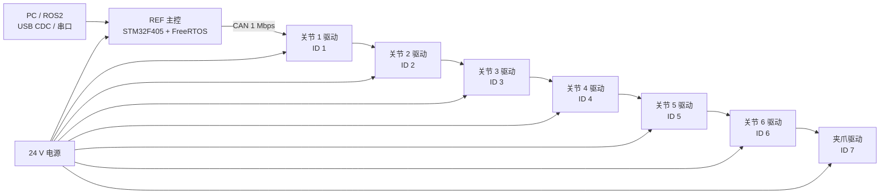
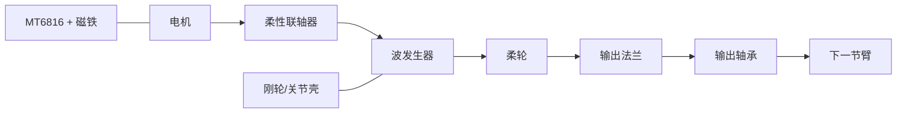
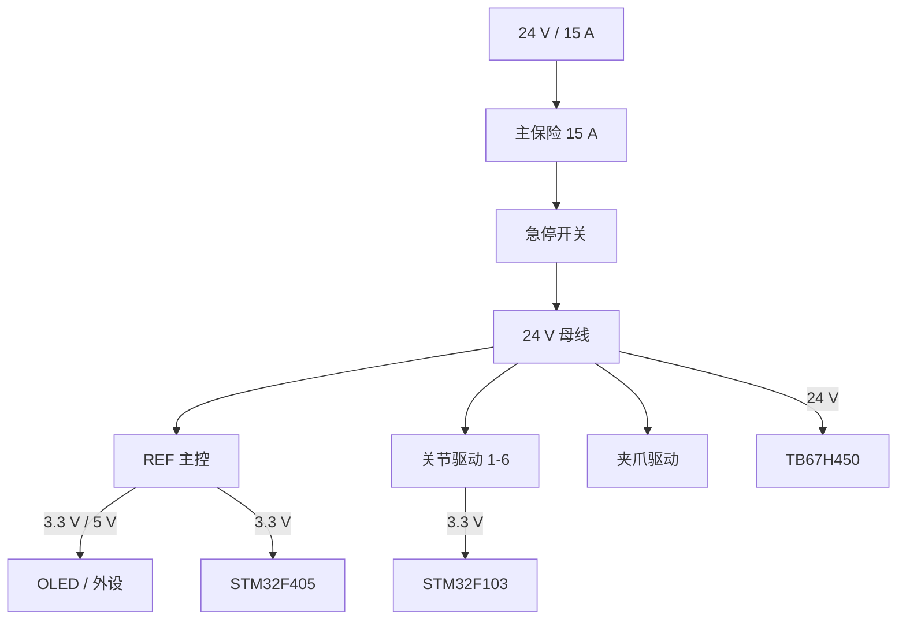
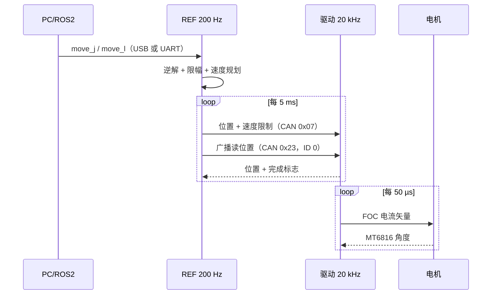
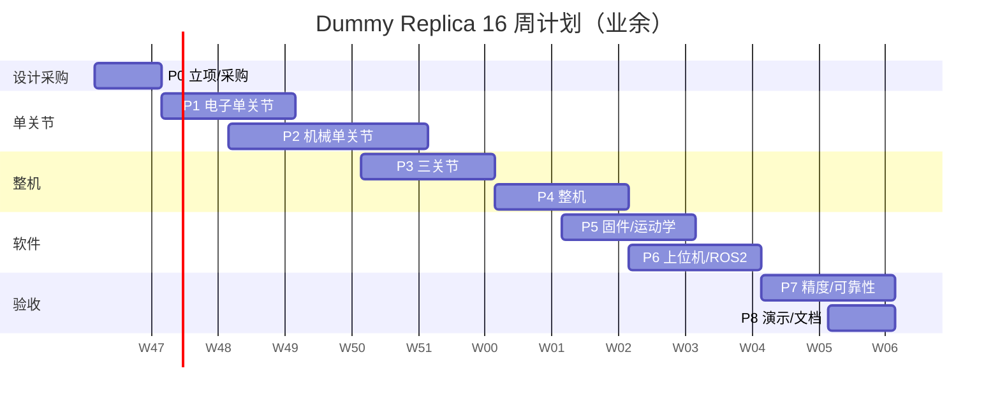

# Dummy Replica：六轴桌面机械臂复刻工程

> 基于 [peng-zhihui/Dummy-Robot](https://github.com/peng-zhihui/Dummy-Robot) 的工程化复刻方案。你给的 [coregiu/Dummy-Robot](https://github.com/coregiu/Dummy-Robot) 是上游仓库的 fork，代码/图纸与上游同源；本文默认以上游 `main` 分支为准。
>
> 文档版本：`v0.1` · 2026-11 · 面向个人或 2-3 人小团队的单台复刻，不是量产方案。

**一句话结论：** 保留原版的“REF 控制器 + Ctrl-Step 一体化关节驱动 + CAN 总线”电子架构，用“国产谐波/降本结构 + 3D 打印与铝板混合”把成本压到 5k-8k，按“单关节 → 三关节 → 整机”的阶段门推进；不要一上来就 1:1 抄全部零件。

---

## 0. TL;DR：先看这 12 条

1. 原版是 2021 年的**工程原型**，不是开箱套件。作者在 README 里明确说“成本和制作难度都比较高”，并让想复现的人等“青春版”；但截至仓库当前状态，青春版并未随仓库发布。**不要按 2000 元做预算。**
2. 复刻的最大难点不是运动学代码，而是**谐波减速器、结构刚性、编码器标定**。代码能跑不代表机械能跑。
3. 推荐路线：**原版电子架构 + 降本机械结构**。先做 1 个关节，打通“电机 → 驱动 → CAN → 标定 → 闭环 → 重复定位”，再把同一套模块复制 6 次。
4. 预算分三档：**3k 能动、6k 能用、10k 能打**。推荐 6k 左右（5k-8k，不含 3D 打印机、CNC、示波器等一次性工具）。
5. 周期：全职 8-10 周，业余 4-6 个月。谐波减速器和 PCB 是长周期物料，**先下单再画图**。
6. 本方案目标：6 轴 + 夹爪、3D 半径约 0.46 m、水平工作半径约 0.38 m、最高约 0.45 m、负载 0.5 kg、重复定位 ≤0.1 mm、24 V 供电、CAN 1 Mbps。
7. 不要 1:1 抄原版的 20 步进 + CSF-5 小件。用 35 步进或 42 slim 重画腕部，货源、成本、装配难度都更好。
8. 原版 `MoveL` 不是直线插补，而是“目标点逆解 + 关节空间运动”。要画直线、做 3D 打印/雕刻，必须在 ROS2/上位机做笛卡尔插补，或自己补固件的 TRJ 模式。
9. 原版没有独立的 SYNC 影子寄存器。6 轴位置指令是连续 CAN 帧，硬同步要自己加广播 SYNC 帧或改用时间戳协议。
10. 原版 `CalibrateHomeOffset()` 实际是“手动摆到 L 位 + 应用零点”，README 里描述的“电流环碰限位自动找粗零点”并没有完整开源实现；自动回零要自己写。
11. 原版仓库**没有 LICENSE 文件**。个人学习复刻可以，二次分发、商用、挂“Dummy”名字之前先解决授权和商标问题。
12. 如果你只记住一件事：**先买减速器，再画结构；先做单关节，再做整机。**

> **阅读指南**：赶时间看第 0 节；选型看第 3 节；动手看第 7 节；避坑看 1.6 和第 10 节；BOM 看第 8 节；验收看第 9 节。

---

## 1. 原始项目拆解

### 1.1 它到底是什么

Dummy 是稚晖君 2021 年发布的 6 轴桌面机械臂项目，核心特征：

- 6 个旋转关节 + 1 个两指夹爪；
- 42 步进电机 + 谐波减速器（部分关节带同步带级）；
- 每个关节一块**一体化闭环驱动板**：STM32F103 + TB67H450 + MT6816 磁编码器 + CAN；
- 一台 REF 主控（STM32F405 + FreeRTOS），CAN 总线串联所有关节，整机走线只有电源和 CAN 四根线；
- 上位机 DummyStudio（Unity，闭源二进制）+ Python CLI 工具；
- 可选 Peak 无线示教器（独立子模块，基于 X-Track 路线）；
- 硬件是 Altium 工程，结构是铝合金 CNC + 3D 打印件；
- 控制算法：DH 解析正逆解、8 组逆解按“最小关节变化”选解、200 Hz 控制循环、梯形速度规划、SEQ/INT/TRJ 三种指令模式。

它的价值不在于参数多高，而在于**把工业机械臂的完整链路压缩到了桌面尺度**：机械、电机、驱动、总线、固件、运动学、上位机，每一层都有可读的实现。

### 1.2 已核对的参数（附可信度）

> 可信度：✅ 代码/模型直接核对；🟡 由代码或几何推算；🔴 需要你按实物复测。

| 项目 | 数值 | 可信度 | 说明 |
|---|---|---|---|
| 自由度 | 6 + 夹爪 | ✅ | 关节 CAN ID 1-6，夹爪 ID 7 |
| 控制器 | STM32F405RGT6，168 MHz | ✅ | `REF-STM32F4-fw.ioc` |
| 关节驱动 | STM32F103CB + TB67H450 + MT6816 | ✅ | 驱动固件与硬件目录 |
| 编码器 | MT6816，14 位单圈绝对式 | ✅ | 16384 计数/圈，SPI |
| 电流环 | 20 kHz | ✅ | `HAL_TIM_Base_Start_IT(&htim4)` |
| 主控循环 | 200 Hz（5 ms） | ✅ | `Timer timerCtrlLoop(&htim7, 200)` |
| 总线 | CAN 1 Mbps，11 位标准帧 | ✅ | 驱动 `Prescaler=4, BS1=5, BS2=3` |
| 关节减速比 | J1=50，J2=30，J3=30，J4=24，J5=30，J6=50 | ✅ | `dummy_robot.cpp` |
| 关节限位 | J1 ±170°，J2 -73~90°，J3 35~180°，J4 ±180°，J5 ±120°，J6 ±720° | ✅ | 同上 |
| 连杆参数 | 0.109 / 0.035 / 0.146 / 0.052 / 0.115 / 0.072 m | ✅ | `DOF6Kinematic(...)` |
| 最大 3D 半径 | ≈0.457 m（不含夹爪） | 🟡 | 按固件 FK + 限位采样 50 万点 |
| 最大水平半径 | ≈0.377 m（不含夹爪） | 🟡 | 同上，Z≈0.12 m 处 |
| 最大高度 | ≈0.451 m（不含夹爪） | 🟡 | 同上 |
| 最低点 | ≈-0.089 m | 🟡 | 同上，注意桌面干涉 |
| 末端理论分辨率 | 0.0007°（30:1 时），0.006 mm@0.45 m | 🟡 | 14 位 × 减速比，未计回差 |
| 推荐负载 | 0.5 kg（1 kg 需加强） | 🟡 | 按静力矩 + 1.5 安全系数估算 |
| 重复定位 | ≤0.1 mm@80% 臂展 | 🟡 | 谐波 lost motion ≈1 arcmin → 0.09 mm@0.3 m |
| 整机重量 | 约 2.5-3.5 kg | 🔴 | 取决于结构和电机 |
| 供电 | 24 V，10-15 A | 🔴 | 原版/社区实践均按 24 V；以原理图为准 |
| 原版谐波 | CSF-8-30-1U ×2、CSF-5-30-1U ×2（STEP 中统计） | ✅ | 其余关节含同步带/齿轮级，具体以装配图为准 |
| 原版电机 | 42 步进为主，20 步进用于小型机构/夹爪 | 🟡 | README 只说明使用 20/42 步进，未给具体分配；STEP 中主体为 NEMA17 |

**重要提醒：** 上面没有“官方规格书”。原版 README 没有给负载、精度、重量的正式数据；媒体口径的“0.02 mm”不可全信。0.1 mm 是基于谐波回差和结构刚性的工程估计，必须实测。

### 1.3 系统架构



四个控制层级：

1. **上位机层**：DummyStudio / Python CLI / ROS2，负责点位、脚本、可视化；
2. **主控层**：200 Hz 任务，做正逆解、关节限幅、速度规划、CAN 收发；
3. **关节驱动层**：20 kHz 电流环 + 位置/速度/电流模式 + 编码器校准；
4. **功率层**：24 V → TB67H450 → 两相步进电机。

关键设计是**把电流环下沉到每个关节**，主控只发“位置 + 速度限制”，因此：

- 关节之间只需要 CAN + 电源，走线极短；
- 每个关节可以独立做标定、堵转保护、LED 状态；
- 主控可以把 6 个关节当成 6 个“智能执行器”，运动学代码很干净。

### 1.4 原版 BOM 重构

| 子系统 | 原版方案 | 数量 | 作用 | 复刻时的现实选择 |
|---|---|---|---|---|
| 主控 | REF 核心板 + REF 底板，STM32F405 | 1 套 | 运动学、CAN 主站、USB、OLED、IMU | 原版/社区改版；或自绘一块 F405 板 |
| 关节驱动 | STM32F103 + TB67H450 + MT6816 + CAN | 6 | 闭环步进驱动 | 原版 PCB；或成品 CAN 闭环步进 |
| 夹爪驱动 | HandModule | 1 | 夹爪电机 | 原版；或 35 步进 + 丝杆 |
| 电机 | 42 步进（部分 slim）+ 20 步进 | 6+1 | 关节/夹爪 | 42 标准 + 42 slim/35；20 步进难买 |
| 减速器 | CSF-8-30、CSF-5-30 + 同步带级 | 4+ | 降速增矩 | 国产 CSF 兼容件；或摆线/行星（精度换成本） |
| 结构 | 铝合金 CNC + 3D 打印 | 1 套 | 臂体、关节壳、底座 | 3D 打印 PA-CF + 铝板混合 |
| 电源 | 24 V 适配器 | 1 | 整机供电 | 24 V/15 A 工业电源 |
| 上位机 | DummyStudio（Unity） | 1 | 图形化控制 | Windows 二进制；或自写 Python/ROS2 |
| 调试 | CLI-Tool（fibre/ODrive 改） | 1 | 命令行 | 半成品，建议自写 100 行脚本 |

### 1.5 原版最值得抄的 6 个设计

1. **一体化关节驱动 + CAN 串联**
   每个关节把 MCU、功率级、编码器、CAN 收发都放在电机屁股后面，主控只出 4 根线。对比 GRBL 的 step/dir 脉冲方案，末端关节不需要长距离脉冲线，也不会因为脉冲频率限制丢掉高速性能。

2. **单圈绝对值编码器 + 减速器 + 无行程开关回零**
   编码器只在电机轴一圈内绝对，经过减速后，输出端一圈对应电机几十圈，单圈信息不够。原版的思路是：上电后用**低力矩电流环**让关节缓慢撞向机械限位，确认粗零点（30:1 时窗口 12°，50:1 时 7.2°），再用单圈绝对值编码器在窗口内精调。这样不需要限位开关，也不受加工误差影响。**注意：这个自动流程在开源固件里没有完整实现，见 1.6。**

3. **解析逆解 + 8 组解 + 最小关节变化选解**
   作者说明该构型满足 Pieper 判据（后三个关节轴交于一点），所以逆解可以写成解析式，得到 8 组解。固件先按关节限位过滤，再选“6 个关节最大变化角最小”的那组，保证姿态切换自然、不绕远路。

4. **200 Hz 主控 + 20 kHz 电流环 + 多轴按最大关节时间同步**
   `MoveJ` 收到 6 个目标角后，算 6 个差分角，取最大角 θ，按设定的 JointSpeed 算运动时间，再把其余 5 个关节的加减速度和最高速度按比例缩放，让 6 个关节同时到达。驱动器内部再做梯形加减速规划。

5. **SEQ / INT / TRJ 三种指令模式**
   - SEQ：FIFO 队列，逐条执行，适合抓取、码垛；
   - INT：新指令覆盖旧指令，适合遥操作、视觉伺服；
   - TRJ：固定周期轨迹流，适合绘画、3D 打印。
   这个抽象很好，但 TRJ 在原版里是 ToDo（见 1.6）。

6. **分层固件 + fibre 协议**
   `Bsp / Core / Robot / UserApp` 分层，`DummyRobot` 类把“关节配置 + DH + 运动学”封装在一起，`CtrlStepMotor` 把 CAN 协议封装成 C++ 方法。二次开发只需要改 `UserApp` 和 `Robot/instances`，不用碰 HAL。

### 1.6 原版没告诉你的 11 个坑

> 这一节是本文最有价值的部分。很多“保姆教程”会跳过这些。

1. **“青春版”没有随仓库发布。**
   README 承诺 3D 打印 + 摆线减速器 + 2000 元以内，但当前仓库仍是原版方案。你可以参考作者的 `CycloidAcuratorNano` 仓库自己做摆线，但不要假设“照着 README 就能 2000 元搞定”。

2. **硬件源文件是 Altium，不是 Gerber。**
   `Controller / Dangle / REF / HandModule / LedRing` 只有 `.PcbDoc/.SchDoc`，没有可直接打样的 Gerber；只有 `MotorDriver-42/57` 带 Gerber。你要么有 Altium 导出并做 DFM，要么用社区改版板，要么换成品驱动。

3. **20 步进和 CSF-5 小谐波不好买。**
   原版使用了 20 步进和 CSF-5 小谐波；这类小件二手市场少、一致性差。社区方案普遍改用 35 步进/42 slim + 重新设计腕部。**这是复刻时最值得改的地方。**

4. **DummyStudio 是闭源 Windows 二进制。**
   仓库里只有 `DummyStudio.exe` 和 Unity 数据，没有源码；跨平台、二次开发都受限。CLI 工具是 ODrive fibre 框架改的，里面有 `odrv0`、`axis0` 等残留，`run_shell.py` 的 `sys.path` 还指向不存在的 `../Firmware/fibre/python`。**不要指望它开箱即用。**

5. **TRJ 模式没有真正实现。**
   README 的表格把 TRJ 标成 `ToDo`；代码里 `COMMAND_CONTINUES_TRAJECTORY` 在 `ParseCommand()` 里和 SEQ 共用分支，没有固定周期插值。要做轨迹跟踪，得自己补。

6. **`MoveL` 不是直线插补。**
   `DummyRobot::MoveL()` 只对目标点做一次逆解，然后调用 `MoveJ()` 走到目标关节角。末端走的是关节空间曲线，不是笛卡尔直线。**画直线、3D 打印、雕刻会得到弧线。**

7. **没有独立 SYNC 帧。**
   驱动 `HAL_CAN_RxFifo0MsgPendingCallback()` 接受 `id==0` 的广播，但 `OnCanCmd()` 收到位置指令就立即执行，没有“影子寄存器 + 广播触发”的实现。6 轴指令是主控在 200 Hz 循环里连续发的 6 帧，同步误差约 1 ms 级。要硬同步，自己加 `0x08 SYNC`。

8. **回零流程和 README 描述不一致。**
   `CalibrateHomeOffset()` 的注释是 “Manually move joints to L-Pose”，然后 `ApplyPositionAsHome()`；它没有自动碰限位找粗零点的代码。README 里描述的是设计思路，不是现成实现。**自动回零需要自己写，并且要加碰撞保护。**

9. **REF 固件启动会死等 MPU6050。**
   `main.cpp` 里：
   ```cpp
   do {
       mpu6050.Init();
       osDelay(100);
   } while (!mpu6050.testConnection());
   ```
   如果你为了降本不焊 IMU，固件会卡死在这里。要么装 MPU6050，要么改启动逻辑。

10. **J6 的 ±720° 会绕线。**
    4 圈行程不是靠软件限位就能解决的；没有滑环的话，线束会被拧断。复刻时要么把 J6 软件限位改成 ±180°/±360°，要么加胶囊滑环。

11. **没有 LICENSE。**
    仓库根目录没有 LICENSE 文件。没有许可证不等于“随便用”：默认保留所有权利。个人学习、自己玩没问题；把原版图纸/代码打包卖、或挂“Dummy”品牌商用，风险很高。

---

## 2. 复刻目标与边界

### 2.1 开工前必须回答的 6 个问题

| # | 问题 | 选项 | 如果不想选，用默认 |
|---|---|---|---|
| 1 | 你要“像”还是“能用”？ | 外观复刻 / 功能复刻 / 学习平台 | 功能复刻 |
| 2 | 预算上限（不含工具）？ | 3k / 6k / 12k | 6k |
| 3 | 你有哪些制造资源？ | 3D 打印 / CNC / Altium / 都没有 | 3D 打印 + 外协铝板 |
| 4 | 负载和精度目标？ | 0.5 kg + 0.1 mm / 1 kg + 0.05 mm | 0.5 kg + 0.1 mm |
| 5 | 上位机生态？ | DummyStudio / Python / ROS2 + MoveIt | Python + ROS2 |
| 6 | 时间投入？ | 全职 / 业余 | 业余 4-6 个月 |

**默认答案对应的就是本文推荐的路线 B。** 如果你的答案差异很大，直接跳到第 3 节看路线对比，不要照搬 BOM。

### 2.2 目标分层

| 层级 | 内容 | 必须/可选 |
|---|---|---|
| MVP | 6 轴 + 夹爪、CAN 控制、关节标定、MoveJ、回零、软限位、急停 | 必须 |
| 可用 | MoveL（笛卡尔插补）、点位脚本、Python SDK、重复定位 ≤0.1 mm、0.5 kg 负载 | 必须 |
| 好用 | ROS2/MoveIt、URDF、RViz、手眼标定、轨迹录制 | 可选 |
| 展示 | 绘画/码垛/语音/视觉抓取、外壳、灯环、无线示教 | 可选 |
| 非目标 | 工业级防护、IP54、功能安全认证、24/7 连续运行、量产成本 | 不做 |

### 2.3 验收指标

| 类别 | 指标 | 目标值 | 测量方法 |
|---|---|---|---|
| 机械 | 重复定位 | ≤0.1 mm@80% 臂展，0.5 kg | 百分表/激光，30 次循环 |
| 机械 | 反向回差 | ≤1 arcmin（谐波）；≤3 arcmin 可接受 | 锁输入，输出端加 ±2 N·m，打表 |
| 机械 | 负载 | 0.5 kg 连续，1 kg 静态保持 | 砝码 + 30 min |
| 机械 | 末端速度 | ≥30°/s 关节速度 | 示波器/日志 |
| 电气 | CAN 误码 | 1 h 连续运动，0 bus-off | `candump`/驱动计数 |
| 电气 | 温升 | 电机 <70°C，驱动 <80°C | 热电偶/红外 |
| 控制 | 回零重复性 | ≤0.05° | 10 次上电，记录零点 |
| 控制 | 关节跟随误差 | ≤0.1°（稳态） | 驱动 0x23 反馈 |
| 软件 | 通信周期 | 200 Hz 稳定，抖动 <20% | 日志时间戳 |
| 安全 | 急停 | <0.5 s 切断动力 | 实测 |
| 文档 | BOM/图纸/测试记录 | 完整、可复现 | 仓库检查 |

---

## 3. 路线选型

### 3.1 三条路线

| 维度 | 路线 A：原版忠实复刻 | 路线 B：降本复刻（推荐） | 路线 C：重构/高性能 |
|---|---|---|---|
| 结构 | 6061 CNC，外观接近原版 | 3D 打印 PA-CF + 铝板关键件 | 3D 打印/CNC + 自研关节 |
| 减速器 | 原版 CSF-8/5 谐波 | 国产 CSF 兼容谐波 | 谐波/摆线/行星 |
| 电机 | 42 + 20 步进 | 42 + 42 slim/35 步进 | BLDC + FOC（Dummy2 路线） |
| 电子 | 原版 REF + Ctrl-Step | 原版/社区改版 | 自研 CAN/EtherCAT 控制器 |
| 固件 | 原版，改参数 | 原版，改参数 + 补丁 | 新写/ROS2 原生 |
| 成本 | 12k-18k | 5k-8k | 7k-12k |
| 周期（业余） | 5-7 个月 | 3-4 个月 | 5-8 个月 |
| 精度潜力 | ≤0.1 mm | 0.1-0.2 mm | ≤0.05 mm |
| 风险 | 高（缺件、CNC、成本） | 中 | 高（自研驱动） |
| 适合 | 收藏/展示/必须像 | 学习 + 实际用 | 研究/产品原型 |

### 3.2 决策矩阵

权重按“第一次复刻”的成功率来定：

|  criterion | 权重 | A | B | C |
|---|---:|---:|---:|---:|
| 成功率 | 30% | 3 | 5 | 2 |
| 成本 | 20% | 1 | 4 | 2 |
| 周期 | 15% | 2 | 4 | 2 |
| 性能上限 | 15% | 4 | 3 | 5 |
| 可维护/可扩展 | 10% | 3 | 4 | 5 |
| 外观/还原度 | 10% | 5 | 3 | 2 |
| **加权** | 100% | **2.80** | **4.05** | **2.75** |

> 打分是主观的，但结论很清楚：第一次做，选 B。

### 3.3 推荐：路线 B

具体配置：

| 部件 | 推荐 | 备选 | 理由 |
|---|---|---|---|
| 主控 | 原版 REF（STM32F405） | 社区改版 REF | 固件现成，CAN/USB/OLED 都够用 |
| 关节驱动 | 原版 Ctrl-Step，7 块 | 成品 CAN 闭环步进 | 原版协议与固件匹配；成品省焊接但改协议 |
| 电机 J1-J3 | 42 标准，0.45 N·m，2 A | 42 48mm 闭环 | 力矩够 0.5 kg |
| 电机 J4-J6 | 42 slim 或 35，0.2-0.3 N·m | NEMA14 | 腕部轻，减惯性 |
| 减速器 J1 | 50:1 国产谐波 | 30:1 + 同步带 | 匹配固件参数；50:1 力矩余量大 |
| 减速器 J2/J3 | 30:1 国产谐波 | 50:1（降速） | 匹配固件；30:1 速度好 |
| 减速器 J4/J5 | 30:1 / 24:1 国产谐波或同步带 | 行星（精度差） | 腕部力矩小，可用同步带降本 |
| 减速器 J6 | 50:1 国产谐波 | 30:1 + 同步带 | 末端旋转，回差要求高 |
| 结构 | PA-CF 3D 打印 + 6061 铝板 | 全 CNC | 关键承力件用铝，外壳打印 |
| 夹爪 | 35 步进 + 丝杆 | 总线舵机 | 步进保持力好；舵机省事但协议要转 |
| 电源 | 24 V/15 A | 24 V/10 A（限流） | 6×2 A 峰值 |
| 上位机 | Python SDK + ROS2 | DummyStudio | 开源、可扩展 |

### 3.4 不推荐的路线

- **纯 3D 打印摆线减速器作为第一次尝试。** 摆线设计、预紧、材料蠕变、回差，每一个都能让你调一个月；除非你就是想研究摆线，否则第一台用国产谐波。
- **GRBL/脉冲方案。** 末端关节要拉 step/dir 线，走线长、只能位置模式、没有力矩/速度模式，和 Dummy 的设计哲学相反。
- **廉价行星减速器。** 10-30 arcmin 回差，末端 0.5-1.5 mm 误差，做出来“能动但不好用”。
- **1:1 抄原版的 20 步进/CSF-5 小件。** 买不到、修不了、换不了；用 35/42 slim 重画腕部，性能更好。
- **一上来就 6 轴全做。** 你没有 6 次试错预算；先做 1 个关节。

### 3.5 架构决策记录（ADR）

| ID | 决策 | 理由 | 代价 |
|---|---|---|---|
| ADR-001 | 用 CAN，不用脉冲 | 4 线串联、支持力矩/速度/位置、关节可独立标定 | 需要 CAN 分析仪、协议调试 |
| ADR-002 | 24 V 供电 | 同功率电流小、驱动器兼容、原版生态 | 需要 DC-DC、注意安全 |
| ADR-003 | J1-J3 用谐波，J4-J6 可混合 | 谐波回差小、力矩密度高；腕部负载小 | 成本高、交期长 |
| ADR-004 | 保留 REF 架构 | 固件/协议/运动学现成 | 受限于原版 F405 和代码质量 |
| ADR-005 | 第一台用步进，不用 BLDC | 步进保持力好、驱动简单、成本低 | 高速/高效率不如 BLDC |
| ADR-006 | 先单关节，后整机 | 降低试错成本，尽早发现装配/标定问题 | 总周期看起来更长 |

---

## 4. 机械方案

### 4.1 构型与 DH 参数

原版是 6R 串联构型。作者说明该构型满足 Pieper 判据（后三轴交于一点），因此固件采用解析逆解。固件里的 DH 表（单位 m，角度为 θ 偏移）：

| i | θ offset | a(i-1) | d(i) | α(i-1) | 对应 |
|---|---:|---:|---:|---:|---|
| 1 | 0 | 0.109 | 0.035 | -90° | 底座偏置 |
| 2 | -90° | 0 | 0.146 | 0 | 大臂 |
| 3 | +90° | 0.052 | 0 | +90° | 肘部偏置 |
| 4 | 0 | 0.115 | 0 | -90° | 小臂 |
| 5 | 0 | 0 | 0 | +90° | 腕部 |
| 6 | 0 | 0.072 | 0 | 0 | 末端 |

固件对应代码：

```cpp
dof6Solver = new DOF6Kinematic(
    0.109f,  // L_BASE
    0.035f,  // D_BASE
    0.146f,  // L_ARM
    0.115f,  // L_FOREARM
    0.052f,  // D_ELBOW
    0.072f   // L_WRIST
);
```

> 注意构造函数的参数顺序是 `L_BS, D_BS, L_AM, L_FA, D_EW, L_WT`，和 DH 表的列不是一一对应；改参数时对着 `6dof_kinematic.cpp` 的 `tmp_DH_matrix` 一行一行改，别凭感觉。

### 4.2 工作空间与奇异点

按固件 FK + 关节限位采样 50 万点：

- 最大 3D 半径：**0.457 m**（不含夹爪）；
- 最大水平半径：**0.377 m**（Z≈0.12 m，不含夹爪）；
- 最大高度：**0.451 m**（不含夹爪）；
- 最低点：约 **-0.089 m**（注意桌面干涉）。

这意味着它是一台“偏高、接近半米”的桌面臂。实际布局时：

- 工作台深度至少 0.6 m，高度至少 0.7 m；
- 不要把常用工作点放在最大伸展处（奇异/刚性最差）；
- 避免 J5≈0° 的腕部奇异（J4 和 J6 轴重合），否则逆解退化、关节速度飙升；
- 避免 J2/J3 同时接近限位端点的极端伸展/折叠姿态，末端受力时变形最大。

#### 负载/力矩粗算

假设：负载 0.5 kg，力臂保守取 0.45 m；大臂 0.6 kg@0.07 m、小臂 0.5 kg@0.22 m、腕部 0.4 kg@0.35 m；谐波效率 η=0.7。**下表只算静态保持力矩，动态还要再加 1.5× 余量；这是估算，不是实测。**

| 关节 | 静态重力力矩（N·m） | 减速比 | 电机侧需求（N·m） | NEMA17 0.45 N·m 余量 |
|---|---:|---:|---:|---:|
| J1 | ≈0（绕垂直轴，重力不产生力矩） | 50 | 按惯量/摩擦选 | — |
| J2 | ≈5.1 | 30 | ≈0.24 | ≈1.9× |
| J3 | ≈2.1 | 30 | ≈0.10 | ≈4.5× |
| J4-J6 | <0.5 | 24-50 | <0.03 | >10× |

结论：

- 0.5 kg 用 42 步进 + 30/50:1 谐波是够的，J2 余量最小；
- J2 是瓶颈：静态余量 1.9×，动态加速会吃掉一半；建议 J2 电流设 2 A、加速度先给 30%，实测再往上加；
- 1 kg 时 J2 静态力矩约 7.3 N·m，电机侧约 0.35 N·m，余量只剩 1.3×，动态会偏紧；要 1 kg 建议 J2 用 50:1 或 0.6 N·m 电机；
- 3D 打印件的柔性、谐波效率、联轴器偏心会继续吃掉余量，**不要按 1.0× 设计**。

### 4.3 关节模块设计

一个关节的推荐爆炸顺序：

```
电机 → 柔性联轴器 → 谐波波发生器 → 刚轮（固定）→ 柔轮（输出）
                                      ↓
                              输出法兰 → 交叉滚子轴承/一对角接触轴承 → 下一节臂
```

关键点：

1. **减速器刚轮固定到关节壳，柔轮接输出法兰**；不要反过来，否则受力路径不对。
2. **输出端必须有独立轴承**，不能靠谐波本身承受弯矩；CSF 系列允许的弯矩有限。
3. **电机轴与波发生器同轴度 ≤0.05 mm**；用柔性联轴器补偿，不要刚性套。
4. **编码器磁铁装在电机轴尾端**，与 MT6816 的间隙 0.5-1.5 mm，同心度 ≤0.1 mm；磁铁不要用强磁螺丝刀去吸。
5. **关节壳要有定位销/止口**，不能只靠螺丝摩擦传扭矩；3D 打印件尤其要加铝嵌件或钢制轴承座。
6. **走线留服务环**，每个关节转动时线束不能绷紧；J6 特别处理（见 4.8）。

一个简化剖视图（示意）：



### 4.4 减速器选型

| 类型 | 回差 | 减速比 | 成本 | 制造难度 | 适用 |
|---|---|---|---|---|---|
| 谐波（CSF/国产兼容） | ≤1 arcmin | 30-100 | 高 | 买成品 | J1-J3、J6 |
| 摆线（自制） | 3-10 arcmin | 20-50 | 低 | 高（设计/预紧） | 想复刻“青春版” |
| 行星 | 10-30 arcmin | 3-100 | 低 | 买成品 | 夹爪、低精度关节 |
| 同步带 | 1-5 arcmin（张紧后） | 2-5 | 低 | 低 | 腕部、J4/J5 |
| 蜗轮蜗杆 | 5-15 arcmin | 20-60 | 中 | 中 | 不需要 backdrive 的场合 |

**建议：**

- J1/J2/J3：国产谐波，30:1/50:1，别省；
- J4/J5：小谐波或同步带，按腕部空间选；
- J6：小谐波，50:1；如果只用 ±180°，同步带也能凑合；
- 夹爪：丝杆 + 35 步进，或总线舵机。

> 国产谐波不是“都一样”。买之前让对方提供**lost motion、启动转矩、允许弯矩、润滑脂型号**；到货后自己打表测回差，别只看价格。

### 4.5 材料与工艺

| 工艺 | 材料 | 优点 | 缺点 | 用在哪 |
|---|---|---|---|---|
| FDM | PA-CF / PETG / ABS | 便宜、快、可迭代 | 层间强度、蠕变、吸水 | 外壳、非承力臂、夹具 |
| SLS | PA12 / PA-CF | 各向同性好、精度高 | 贵、表面粗糙 | 复杂腕部零件 |
| CNC | 6061-T6 | 刚性好、精度高 | 贵、慢 | J1-J3 关节壳、底座、输出法兰 |
| 激光切割 | PC/亚克力/铝板 | 快、平面件便宜 | 只能做 2.5D | 摆线盘、侧板、底座板 |

推荐混合：

- **J1/J2/J3 的关节壳、输出法兰、底座**：6061 铝，至少关键承力面用铝；
- **臂体外壳、腕部、夹爪、灯环支架**：PA-CF 打印；
- **摆线盘**（如果走摆线路线）：PC 或 7075 铝，激光切割 + 磨削。

### 4.6 关键公差与装配

| 项目 | 目标 | 检查方法 |
|---|---|---|
| 减速器安装面端面跳动 | ≤0.02 mm | 百分表 |
| 输出法兰端面跳动 | ≤0.05 mm | 百分表 |
| 电机轴/波发生器同轴度 | ≤0.05 mm | 打表 + 联轴器 |
| 输出轴承座配合 | H7/k6 或过渡配合 | 塞规/内径千分尺 |
| 同步带张紧 | 按压 2-3 mm 变形 | 手指/张力计 |
| M3 螺丝扭矩（铝） | 0.5-0.7 N·m | 扭矩起子 |
| M4 螺丝扭矩（铝） | 1.2-1.5 N·m | 扭矩起子 |
| M3 螺丝扭矩（塑料+嵌件） | 0.3-0.5 N·m | 手感/扭矩起子 |
| 关节轴向窜动 | ≤0.02 mm | 百分表 |

装配顺序建议：

1. 清洗减速器安装面，去毛刺；
2. 压入输出轴承，检查转动顺畅；
3. 固定刚轮，打表端面；
4. 装波发生器，涂指定润滑脂（不要混用）；
5. 装柔轮/输出法兰，按对角顺序拧螺丝；
6. 装电机/联轴器，手动转一圈，确认无卡滞；
7. 装编码器磁铁，示波器/软件看波形；
8. 上电，先低速空载，再加载。

### 4.7 3D 打印参数（经验值）

- 材料：PA-CF（推荐）> ABS > PETG > PLA（不建议承力）；
- 层高：0.12-0.16 mm；
- 壁厚：4-6 圈；
- 填充：40-60%，关键件 80%；
- 打印方向：让层间剪切方向避开主要受力方向；
- 热 inserts：M3 铜螺母，孔径按厂商推荐，压入温度 220-240°C；
- 退火：PA-CF 按材料说明 80-100°C/2-4 h，减少内应力；
- 配合面：打印后铰孔/磨平，不要指望 FDM 直接达到轴承配合。

### 4.8 走线与 J6 限位

- J1-J5 的线束走臂体内部或侧槽，每个关节留一个**服务环**（长度 ≈ 关节最大转角对应的弧长 + 10 mm）；
- J6 原版 ±720°（4 圈），普通线束必断。三个选择：
  1. 软件限位改成 ±180°（最简单，推荐第一台）；
  2. 用胶囊滑环（6 线，24 V/信号分开），成本 100-300 元；
  3. 用足够长的柔性硅胶线 + 双向缠绕，限制在 ±360° 以内。
- CAN 和电源分开走，避免电机 PWM 干扰编码器/信号；
- 屏蔽层**单端接地**，不要两端都接，避免地环路。

### 4.9 夹爪

原版夹爪是独立 CAN 节点（ID 7），协议：

- `0x01` 设最大电流（float，0-1 A）；
- `0x02` 设角度（float，0-30，单位由机械结构决定）；
- 使能 = 设电流，失能 = 设 0。

复刻建议：

- 35 步进 + 丝杆/齿条，保持力好，断电不自锁的问题用自锁丝杆或弹簧；
- 行程 0-30 mm，最大电流 0.5-0.7 A；
- 加一个简单的电流检测，夹到物体后限制电流，避免烧电机；
- 如果不想做，先用总线舵机（STS3215/XL330）做原型，再换步进。

### 4.10 底座与配重

- 底座面积 ≥250×200 mm，铝板 8-10 mm 或打印件 + 钢板；
- 四个橡胶脚 + 可选 C 夹固定；
- 最大伸展 + 0.5 kg 负载时，倾覆力矩不小，底座配重 1-2 kg；
- 急停按钮放在手边，不要放在机械臂工作范围内。

---

## 5. 电子方案

### 5.1 系统框图与电源树



要点：

- 24 V 直接进驱动板，板上再降到 5 V/3.3 V；
- 主控和驱动共地，但**功率地和信号地单点连接**；
- 急停切断 24 V 母线，不要只切断 MCU 的使能；
- 母线加 1000 µF 电解 + 33 V TVS，抑制电机换向/回馈尖峰；
- 每个驱动分支加 3 A 保险或电子熔断。

### 5.2 REF 控制器

核心参数：

- MCU：STM32F405RGT6，168 MHz，1 MB Flash，192 KB RAM；
- 2 路 CAN（CAN1/CAN2），1 Mbps；
- USB OTG FS（CDC 虚拟串口）；
- UART4/UART5/USART1；
- I2C1（MPU6050）、I2C2（OLED）、I2C3；
- SPI1/SPI3；
- TIM2/TIM3 编码器接口，TIM9/TIM12 PWM；
- 板载 OLED、IMU、蜂鸣器、LED、按键。

引脚速查（来自 `.ioc`，方便 bring-up）：

| 功能 | 引脚 |
|---|---|
| CAN1 RX/TX | PB8 / PB9 |
| CAN2 RX/TX | PB12 / PB13 |
| USB DM/DP | PA11 / PA12 |
| UART4 TX/RX | PA0 / PA1 |
| UART5 TX/RX | PC12 / PD2 |
| USART1 TX/RX | PA9 / PA10 |
| I2C1 SCL/SDA（IMU） | PB6 / PB7 |
| I2C2 SCL/SDA（OLED） | PB10 / PB11 |
| I2C3 SCL/SDA | PA8 / PC9 |
| SWDIO/SWCLK | PA13 / PA14 |
| LED | PC8 |
| KEY | PC13 |
| ADC | PC2-PC5 |
| TIM9 PWM | PA2 / PA3 |
| TIM12 PWM | PB14 / PB15 |

> 如果你不焊 IMU，记得改 `main.cpp` 的初始化；否则会卡在 `while (!mpu6050.testConnection())`。不焊 OLED 只是没显示，不会卡死。

### 5.3 关节驱动

核心参数：

- MCU：STM32F103CBT6；
- 功率级：TB67H450FNG H 桥（PWM 斩波，电流驱动；每相一个 H 桥，具体数量以原理图为准）；
- 编码器：MT6816CT-STD，14 位 SPI 绝对式；
- 电流环：20 kHz；
- 位置环：DCE（P + 速度前馈 + 积分 + 微分），参数可调；
- CAN：1 Mbps，11 位 ID；
- 供电：24 V；
- 默认电流限制 1 A；`dummy_robot.h` 的调参表给出 2 A，但需要在初始化/上位机里显式设置；
- 支持位置/速度/电流模式、堵转保护（默认关闭，需 `0x1B` 打开）、EEPROM 参数、按键校准。

驱动板的 bring-up 顺序：

1. 只焊电源部分，上 24 V，测 5 V/3.3 V；
2. 焊 MCU，ST-Link 能识别；
3. 焊 CAN 收发器，回环/总线测试；
4. 焊 TB67H450，**先不接电机**，测输出无短路；
5. 焊 MT6816，读 SPI 原始值，转磁铁看变化；
6. 接电机，限流 0.5 A，第一次上电做编码器校准；
7. 校准通过后，再逐步加电流/速度。

**编码器校准**是驱动板最容易被卡住的一步：

- 首次上电（或同时按住两个按键上电）会自动校准；
- 电机会正转约 2 圈、再反转约 1 圈，建立 200×256=51200 点的角度映射表（基于 16384 点原始角度）；
- 校准失败常见原因：电机相序错、磁铁间隙不对、磁铁偏心、电源限流太低、编码器 SPI 焊接不良；
- 校准成功后校准表存 Flash，节点 ID/电流/零点等参数存 EEPROM，下次上电不需要重做；
- 换电机/换磁铁/拆编码器后必须重新校准。

### 5.4 CAN 总线

- 速率：1 Mbps；
- 帧格式：11 位标准帧，DLC=8；
- ID 定义：`StdId = (node_id << 7) | cmd`；
- node_id：1-6 关节，7 夹爪，0 广播；
- 数据：小端 float32 放 byte0-3，byte4 用作“保存/ACK”标志；
- 终端电阻：总线两端各 120 Ω，中间节点不要加；
- 拓扑：手拉手菊花链，不要星形；
- 线材：双绞线（CANH/CANL）+ 电源线，22-24 AWG 信号，20 AWG 电源；
- 屏蔽：单端接地；
- 分支长度：<0.3 m；
- 共地：主控和驱动必须共地，否则 CAN 差分参考漂移。

总线负载估算：

- 一帧标准 CAN 约 110-130 bit（含 stuffing），1 Mbps 下约 130 µs；
- 200 Hz 循环，6 个位置指令 + 6 个反馈 = 12 帧/5 ms ≈ 1.56 ms，占空比 ~31%；
- 加夹爪和调试帧，约 35-40%，1 Mbps 够用，但不要再塞大量日志。

### 5.5 电源与安全

- 电源：24 V/15 A（360 W），工业开关电源，带过流/过压保护；
- 主保险：15 A 慢断；
- 分支保险：每个关节 3 A；
- 急停：双极切断 24 V，带自锁；
- 上电顺序：先控制，后动力（如果做得到）；至少保证急停可控；
- 回馈：步进电机减速时可能回馈，母线加 TVS + 电解；如果频繁过压，加制动电阻/泄放；
- 防反接：MOS 理想二极管或肖特基；
- 接地：PE 接金属外壳；24 V 负极按电源/安规要求单点接地，避免与电机功率地形成环路；
- 测试时用**限流电源**，第一次上电限 0.5 A。

### 5.6 线束与连接器

| 回路 | 推荐连接器 | 线径 | 备注 |
|---|---|---|---|
| 24 V 母线 | XT30/XT60 或 5.08 mm 端子 | 18-20 AWG | 防反接、锁扣 |
| 关节电源+CAN | 1.5 mm 6P（电源 2 针并联）或 XT30 + 4P | 20-22 AWG 电源 / 24 AWG 信号 | 原版 1.0 mm 易脱落；GH1.25 只适合信号 |
| 电机相线（两相四线） | JST-XH 4P 或焊接 | 20-22 AWG | 不要热插拔 |
| 编码器 | 板载/FFC | — | 远离电机线 |
| 急停 | 5.08 mm 端子 | 18 AWG | 双极 |

> 原版关节之间用 6P 排线（电源+CAN），同向/反向线要分清；不同批次的驱动板针序可能不同，**上电前用万用表逐根确认**，不要凭颜色。

### 5.7 PCB 打样与焊接

原版硬件是 Altium 工程，步骤：

1. 用 Altium 打开 `.PrjPCB`，检查原理图/PCB 版本；
2. 导出 Gerber + BOM + 坐标文件；
3. 检查 DFM：线宽/间距/孔环/阻焊；
4. 关键器件（TB67H450、MT6816、CAN 收发器、STM32）确认现货/替代；
5. 先各打 2-3 片（REF 2、驱动 2-3），单关节验证后再补 5 片；不要一次打 14 片；
6. 手工焊或 SMT：先焊电源，再焊 MCU，最后焊功率级；
7. 每块板单独测试，不要 6 块一起上电。

如果没有 Altium：

- 用社区改版板（注意许可证）；
- 或把驱动换成成品 CAN 闭环步进（如 ZDT Emm42），但 REF 固件要改 `CtrlStepMotor` 的协议适配；
- 或自己用 KiCad 重画（工作量 1-2 周，但可控）。

### 5.8 替代电子方案

| 方案 | 优点 | 缺点 | 适合 |
|---|---|---|---|
| 原版 REF + Ctrl-Step | 协议/固件匹配，体积小 | PCB 焊接/调试工作量大 | 路线 A/B |
| 成品 CAN 闭环步进 + USB-CAN | 开箱即用，省 PCB | 体积大、协议要适配、价格高 | 快速原型 |
| ODrive/自研 BLDC | 性能高、支持力矩 | 成本/调试难度高 | 路线 C |
| 总线舵机 | 最省事 | 刚性/精度差、电压不同 | 夹爪/教学 demo |

---

## 6. 固件与算法

### 6.1 代码地图

| 目录 | 内容 | 你主要改什么 |
|---|---|---|
| `2.Firmware/Core-STM32F4-fw/Bsp` | OLED、IMU、CAN、USB、UART、EEPROM、PWM | 一般不动 |
| `Core` | CubeMX 生成的 HAL 初始化 | 引脚/时钟 |
| `Drivers` | ST HAL/CMSIS | 不动 |
| `Middlewares` | FreeRTOS、USB | 不动 |
| `Robot/algorithms/kinematic` | DH 正逆解 | 改 DH/限位 |
| `Robot/actuators/ctrl_step` | CAN 关节抽象 | 改协议/超时 |
| `Robot/instances/dummy_robot.cpp` | 关节配置、MoveJ/MoveL、回零 | **主要改这里** |
| `UserApp` | 任务、协议、命令解析 | 加功能 |
| `2.Firmware/Ctrl-Step-Driver-STM32F1-fw` | 关节驱动固件 | 改电流/速度/校准 |
| `3.Software/CLI-Tool` | Python CLI | 可重写 |
| `3.Software/DummyStudio` | Unity 二进制 | 不可改 |

### 6.2 构建与烧录

依赖：

```bash
sudo apt install -y gcc-arm-none-eabi binutils-arm-none-eabi \
    libnewlib-arm-none-eabi libstdc++-arm-none-eabi-newlib \
    cmake ninja-build openocd stlink-tools git
```

拉代码（含子模块）：

```bash
git clone --recursive https://github.com/coregiu/Dummy-Robot.git
cd Dummy-Robot
```

编译 REF 固件：

```bash
cd 2.Firmware/Core-STM32F4-fw
cmake -B build -G Ninja -DCMAKE_BUILD_TYPE=Release
cmake --build build -j
# 输出：build/Core-STM32F4-fw.elf / .hex / .bin
```

编译关节驱动：

```bash
cd 2.Firmware/Ctrl-Step-Driver-STM32F1-fw
cmake -B build -G Ninja -DCMAKE_BUILD_TYPE=Release
cmake --build build -j
# 输出：build/Ctrl-Step-STM32-fw.elf / .hex / .bin
```

烧录（ST-Link + OpenOCD）：

```bash
# REF，SWD：PA13/PA14
openocd -f interface/stlink.cfg -f target/stm32f4x.cfg \
  -c "program build/Core-STM32F4-fw.elf verify reset exit"

# 驱动，SWD
openocd -f interface/stlink.cfg -f target/stm32f1x.cfg \
  -c "program build/Ctrl-Step-STM32-fw.elf verify reset exit"
```

> 驱动仓库里有编译好的 `2.Firmware/_Released HEX/Ctrl-Step-Driver-STM32F1-fw.hex`，板子硬件版本一致时可以直接烧。REF 没有现成 hex，必须自己编译。

### 6.3 控制流



关键时序：

- REF 的 TIM7 产生 200 Hz 中断，唤醒控制任务；
- 控制任务调用 `MoveJoints()`，给 6 个关节发位置+速度；
- `UpdateJointAngles()` 用 ID 0 广播 `0x23`，各关节用自己的 ID 回复；
- 驱动 20 kHz 中断里跑编码器更新 + 闭环；
- 驱动 100 Hz 中断处理按键/LED。

### 6.4 运动学

正解：按 DH 连乘 6 个变换矩阵，得到末端位姿。

逆解：利用后三轴交于一点，先解腕心，再解前三个关节，得到 8 组解：

```
2（肩左/右）× 2（肘上/下）× 2（腕翻转）= 8
```

固件选解逻辑：

1. 按每个关节的 `angleLimitMin/Max` 过滤；
2. 对每组解，算 `currentJoints - solution` 的 6 个差值；
3. 取“最大差值最小”的那组，保证运动量最小；
4. 如果无解，返回 false，上层保持原位。

二次开发注意：

- 改连杆长度后，正逆解要一起改，不要只改 FK；
- 角度单位是度，DH 内部转弧度；
- `Pose6D` 的 A/B/C 是欧拉角，注意万向锁；
- 逆解在奇异点附近会数值不稳定，要加阻尼/拒绝。

### 6.5 轨迹与同步

**MoveJ**：

- 输入 6 个目标关节角；
- 算 6 个差分角，取最大角 θ；
- 按 `jointSpeed` 算时间 `t = θ * reduction / jointSpeed`；
- 其余关节按 `delta * reduction / t` 算速度；
- 6 个关节同时到达（理论上）。

**MoveL**：

- 对目标位姿做一次逆解；
- 调 `MoveJ` 走到目标关节角；
- **不是直线插补**，末端轨迹是关节空间曲线。

**TRJ**：

- README 标 ToDo；
- 代码里 `COMMAND_CONTINUES_TRAJECTORY` 没有独立插值；
- 要做，建议在 ROS2 端做笛卡尔插补，200-500 Hz 下发关节角，或改固件加固定周期轨迹跟踪。

### 6.6 回零与标定

原版有两条“零线”：

1. **编码器校准**：电机轴一圈内的 51200 点映射表（200 个硬步 × 256 细分），解决 MT6816 的安装误差/非线性；
2. **关节零点（home offset）**：把某个机械姿态定义为 0°，存 EEPROM。

推荐流程（自己补自动化）：

1. 机械上设计一个**硬限位**（或让关节撞到结构限位），确保每次上电都能找到同一位置；
2. 上电后，驱动进入**低电流（0.3-0.5 A）位置模式**，以低速向限位方向转；
3. 监测电流/速度：电流上升且速度≈0，判定“碰到限位”；
4. 立即停止，把当前位置记为“粗零点”；
5. 利用单圈绝对值编码器在 360°/减速比 的窗口内，找到精确零点（例如 J2 30:1，窗口 12°）；
6. `ApplyPositionAsHome()` 写入 offset；
7. 再走一个已知姿态（如 L 位），二次校验；
8. 每次上电重复 2-7，记录重复性。

注意事项：

- 硬限位要加缓冲（聚氨酯垫/弹簧），不要让谐波承受冲击；
- 碰限位的电流/时间要可配置，第一次用 0.2 A；
- 碰撞检测要独立于位置环，最好用电流 + 速度双条件；
- 如果没有硬限位，用“机械死挡 + 低电流”也行，但要有急停。

### 6.7 CAN 协议速查

帧格式：`StdId = (node_id << 7) | cmd`，DLC=8，float 小端。

| cmd | 方向 | 功能 | 数据 |
|---|---|---|---|
| `0x01` | 主→从 | 使能/失能 | uint32 1/0 |
| `0x02` | 主→从 | 触发编码器校准 | — |
| `0x03` | 主→从 | 电流模式 | float A |
| `0x04` | 主→从 | 速度模式 | float r/s |
| `0x05` | 主→从 | 位置模式 | float 圈数；byte4=1 要 ACK |
| `0x06` | 主→从 | 位置+时间 | float 圈数 + float 时间 |
| `0x07` | 主→从 | 位置+速度限制 | float 圈数 + float r/s |
| `0x11` | 主→从 | 设节点 ID | uint32 ID；byte4=1 保存 |
| `0x12` | 主→从 | 设电流限制 | float A；byte4=1 保存 |
| `0x13` | 主→从 | 设速度限制 | float r/s；byte4=1 保存 |
| `0x14` | 主→从 | 设加速度 | float r/s²；byte4=0/1 |
| `0x15` | 主→从 | 应用当前位置为零点 | — |
| `0x16` | 主→从 | 上电自动使能 | uint32 1/0；byte4=1 保存 |
| `0x17`-`0x1A` | 主→从 | DCE Kp/Kv/Ki/Kd | int32；byte4=1 保存 |
| `0x1B` | 主→从 | 堵转保护 | uint32 1/0；byte4=1 保存 |
| `0x21` | 从→主 | 读电流 | float A |
| `0x22` | 从→主 | 读速度 | float r/s |
| `0x23` | 从→主 | 读位置 | float 圈数 + 完成标志 |
| `0x24` | 从→主 | 读零点 offset | int32 |
| `0x7E` | 主→从 | 擦除配置 | — |
| `0x7F` | 主→从 | 重启 | — |

示例：节点 1，使能

```
ID  = (1 << 7) | 0x01 = 0x081
Data = 01 00 00 00 00 00 00 00
```

节点 1，位置 1.0 圈（`float 1.0 = 00 00 80 3F`）

```
ID  = (1 << 7) | 0x05 = 0x085
Data = 00 00 80 3F 01 00 00 00
```

Linux SocketCAN 测试：

```bash
sudo ip link set can0 type can bitrate 1000000
sudo ip link set can0 up
cansend can0 081#0100000000000000
cansend can0 085#0000803F01000000
candump can0
```

> 注意：CAN 帧的 Data 是字节流，不同工具对 `#` 后面的十六进制大小写不敏感；float 是小端，别按大端拼。

### 6.8 上位机

三个层次：

1. **DummyStudio**：Windows 二进制，能连、能看、能点，但不能改、不能跨平台；
2. **Python CLI**：仓库自带，但路径/命名有 ODrive 残留，建议自己写；
3. **ROS2**：推荐长期用，自己写 bridge。

一个最小 Python 控制脚本（SocketCAN + struct）：

```python
import can, struct, time

bus = can.Bus("can0", bustype="socketcan", bitrate=1_000_000)

def send_frame(node, cmd, payload=b""):
    data = bytearray(8)
    data[:len(payload)] = payload
    bus.send(can.Message(
        arbitration_id=(node << 7) | cmd,
        data=data,
        is_extended_id=False,
    ))

def enable(node, on=True):
    send_frame(node, 0x01, struct.pack("<I", 1 if on else 0))

def move_pos_vel(node, motor_revs, vel_rps):
    # 0x07: 前 4 字节是电机圈数，后 4 字节是速度限制（r/s）
    send_frame(node, 0x07, struct.pack("<ff", motor_revs, vel_rps))

enable(1)
time.sleep(0.1)
move_pos_vel(1, 1.0, 5.0)   # 电机转 1 圈，速度 5 r/s
```

> 注意：`0x07` 的位置单位是**电机圈数**，不是关节角度。关节角度要先乘以减速比：`motor_revs = joint_deg / 360 * reduction`。上面的例子在 50:1 关节上只让输出转 7.2°。

ROS2 bridge 建议：

- 订阅 `/joint_states`，发布到 CAN；
- 读 CAN 0x23，发布 `/joint_states`；
- 提供 `move_j`、`move_l`、`set_enable` 服务；
- 用 `robot_state_publisher` + URDF 做可视化；
- MoveIt2 用 `FollowJointTrajectory` 接口，频率 100-200 Hz；
- 笛卡尔直线用 `MoveIt2` 的 `computeCartesianPath`，不要指望固件 `MoveL`。

### 6.9 需要改的代码（按优先级）

| 优先级 | 文件 | 改什么 | 原因 |
|---|---|---|---|
| P0 | `Robot/instances/dummy_robot.cpp` | 减速比、限位、DH | 你的机械参数不同 |
| P0 | `UserApp/main.cpp` | 去掉 MPU6050 死等（如果不装） | 否则启动卡死 |
| P0 | `Robot/actuators/ctrl_step/ctrl_step.cpp` | 加超时/重试 | CAN 丢帧时不要卡死 |
| P1 | `dummy_robot.cpp` | 自动回零 | 原版是手动 L 位 |
| P1 | `UserApp/protocols` | 加 `sync`、`estop`、`get_state` | 安全和同步 |
| P1 | `dummy_robot.cpp` | `MoveL` 改笛卡尔插补 | 原版不是直线 |
| P2 | 驱动固件 | 加 0x08 SYNC 影子寄存器 | 多轴硬同步 |
| P2 | 驱动固件 | 加温度/电流日志 | 诊断 |
| P2 | CLI | 重写 | 原版半成品 |

### 6.10 软件测试

- **单元测试**：FK/IK 往返、限位、奇异点、DH 参数；
- **HIL**：CAN 分析仪模拟 6 个关节，测主控时序；
- **日志**：每个周期记录目标/实际/电流/温度，CSV；
- **回归**：每次改参数，跑 100 个随机点，检查无超限；
- **故障注入**：拔 CAN、丢帧、编码器错误、堵转，看是否安全停机。

---

## 7. 实施步骤（核心）

> 原则：**阶段门（gate）不通过，不进入下一阶段。** 每个阶段都有明确的交付物和通过标准，避免“看起来装好了，其实不能用”。

### 7.1 总览

| 阶段 | 时间（业余） | 目标 | 关键交付物 | 通过标准 |
|---|---|---|---|---|
| P0 立项/采购 | W1 | 定路线、下单长周期物料 | 决策记录、BOM、订单 | 减速器/电机/PCB 已下单 |
| P1 电子单关节 | W2-W3 | 1 个关节闭环 | CAN 控制脚本、测试日志 | 校准通过、100 次定位无丢步 |
| P2 机械单关节 | W3-W5 | 1 个关节模块 | 3D/CNC 件、装配记录 | 回差 ≤1 arcmin、重复 ≤0.05 mm |
| P3 三关节 | W5-W7 | 底座+J1-J3 | 三轴臂、线束 | 0.5 kg@0.3 m 保持 30 min |
| P4 整机 | W7-W9 | 6 轴+夹爪 | 整机、走线 | 全关节校准、无绕线 |
| P5 固件/运动学 | W9-W11 | 参数/回零/MoveJ/MoveL | 固件、测试报告 | 100 随机点无超限、回零 ≤0.05° |
| P6 上位机/ROS2 | W11-W13 | Python/ROS2/MoveIt | SDK、URDF、demo | 规划并执行抓取 |
| P7 精度/可靠性 | W13-W15 | 验收 | 测试报告 | 达到第 2.3 节指标 |
| P8 演示/文档 | W15-W16 | 展示 | 视频、README、BOM | 10 次连续成功 |



> 日期只是示意；如果你全职，压缩到 8-10 周；如果等料，顺延。

### 7.2 P0：立项与采购（W1）

**做什么**

1. 读完本文第 1-3 节，确定路线 A/B/C；
2. 建立项目仓库，建 `docs/decision-log.md`、`docs/measurements.md`、`BOM.csv`；
3. 画一张“系统接口图”：电源、CAN、USB、急停、关节编号；
4. 列出长周期物料：谐波、电机、PCB、连接器；
5. 先买**1 套**单关节物料（1 电机 + 1 驱动 + 1 减速器 + 1 编码器），不要一次买 6 套；
6. 同时下单 2 套 PCB（1 套调试，1 套备用）。

**交付物**

- 路线决策记录（含预算/周期/指标）；
- 首版 BOM（含供应商/交期/替代）；
- 单关节物料订单；
- 测试计划草稿。

**通过标准**

- 减速器、电机、驱动板已下单；
- 你知道每个关节的减速比、限位、目标力矩；
- 你有一个限流电源、ST-Link、CAN 分析仪（或至少 USB-CAN）。

**常见坑**

- 先画图后买减速器 → 供应商图纸和实物不一致，全部返工；
- 一次买 6 套 → 发现选型错，退不了；
- 忽略交期 → 等 6 周，项目停摆。

### 7.3 P1：电子单关节（W2-W3）

**做什么**

1. 用洞洞板/转接板接 1 个驱动 + 1 个电机 + 1 个编码器；
2. 24 V/5 A 限流电源，第一次限 0.5 A；
3. 测 3.3 V/5 V 轨、MCU 电流、CAN 收发器；
4. ST-Link 烧驱动固件（先用 released hex，确认硬件版本）；
5. 同时按住两个按键上电，做编码器校准；
6. 用 CAN 分析仪发使能、位置、读位置；
7. 调 DCE 参数：先 Kp，后 Kv，再 Ki/Kd；每次只改一个；
8. 做 100 次 0→1 圈→0，记录位置/电流/温度；
9. 先通过 `0x1B` 打开堵转保护，再故意堵转，确认软件保护/硬件过流/保险生效。

**交付物**

- 单关节测试台照片/视频；
- CAN 报文日志；
- 参数表（电流限制、DCE、速度/加速度）；
- 测试记录（重复性、温升、噪声）。

**通过标准**

- 编码器校准一次通过；
- 100 次定位无丢步，重复性 ≤0.001 圈（电机侧，约 0.36°）；
- 连续运行 10 min，电机 <60°C，驱动 <70°C；
- 堵转 2 s 内保护，不烧板。

**常见坑**

- 电机相序错 → 校准失败/电流大/发热；
- 磁铁间隙/偏心 → 角度跳变；
- CAN 终端电阻缺失 → 时好时坏；
- 电源限流太低 → 校准中途掉电；
- 热插拔电机 → 烧驱动。

### 7.4 P2：机械单关节（W3-W5）

**做什么**

1. 优先选 J2（肩）做第一个关节：它承受的重力力矩最大、最有代表性；如果你想先做简单的，可选 J1，但 J1 绕垂直轴、不承受重力，代表性弱；
2. 按减速器实物画关节壳（先测安装止口/孔距/轴伸）；
3. 3D 打印/CNC 加工；压轴承；装减速器；
4. 打表：安装面跳动、输出法兰跳动、同轴度；
5. 装电机/联轴器，手动转一圈，确认无卡滞；
6. 上电，低速空载，再做负载；
7. 测回差：锁输入，输出端加 ±2 N·m，打表读角度；
8. 测重复性：0→30°→0，30 次，打表；
9. 加载 2 kg（短臂），跑 30 min，记录电流/温度/变形。

**交付物**

- 关节模块 1 套；
- 装配记录（垫片/扭矩/跳动）；
- 回差/重复性/温升数据；
- 问题清单（哪里卡、哪里响、哪里热）。

**通过标准**

- 回差 ≤1 arcmin（谐波）；
- 重复性 ≤0.05 mm@0.2 m；
- 2 kg 静载 30 min，无打滑/异响/过热；
- 手动转动顺滑，无周期性卡顿。

**常见坑**

- 3D 打印件轴承位太松/太紧 → 铰孔/加衬套；
- 输出法兰只靠螺丝摩擦 → 加销/止口；
- 联轴器不同轴 → 振动/噪声/编码器抖动；
- 润滑脂混用 → 减速器发热/寿命下降；
- 没有输出轴承 → 谐波承受弯矩，很快坏。

### 7.5 P3：三关节（W5-W7）

**做什么**

1. 做底座 + J1 + J2 + J3；
2. 线束走到位，每个关节留服务环；
3. 三轴同时使能，低速走一遍工作空间；
4. 加载 0.5 kg@0.3 m，测保持/低速/急停；
5. 记录三个关节的电流/温度；
6. 检查底座倾覆/振动。

**交付物**

- 三轴臂；
- 线束图；
- 负载/温升/振动记录。

**通过标准**

- 0.5 kg@0.3 m 保持 30 min，末端下沉 ≤0.5 mm；
- 低速无爬行/共振；
- 底座不翘、不滑；
- 急停后 0.5 s 内停止。

### 7.6 P4：整机（W7-W9）

**做什么**

1. 加 J4/J5/J6 + 夹爪；
2. 对齐各关节零位，装臂体；
3. 走线，J6 限位/滑环；
4. 整机低速全工作空间测试；
5. 检查干涉/重心/倾覆；
6. 装灯环/OLED/外壳（可选）。

**交付物**

- 整机；
- 整机线束/干涉检查记录；
- 全关节校准记录。

**通过标准**

- 6 个关节都能校准；
- 全工作空间低速无干涉/无拉线；
- 夹爪开合/保持正常；
- 整机重心在底座范围内。

### 7.7 P5：固件/运动学（W9-W11）

**做什么**

1. 改 `dummy_robot.cpp`：减速比、限位、DH；
2. 改 `main.cpp`：去掉 MPU6050 死等（如果不装）；
3. 编译/烧录 REF；
4. 实现自动回零（碰限位 + 编码器精调）；
5. 加软限位、急停、看门狗；
6. 测 MoveJ：6 轴同步、无超调；
7. 测 MoveL：明确它是关节空间，不是直线；如果要直线，先在上位机做插补；
8. 做 100 个随机点，检查逆解/限位/奇异；
9. 记录跟随误差/到位时间。

**交付物**

- 可复现的固件分支/tag；
- 参数表；
- 回零/运动学测试报告。

**通过标准**

- 100 个随机点无超限/无奇异崩溃；
- 回零重复性 ≤0.05°；
- MoveJ 6 轴同步误差 <1%；
- 急停/软限位生效。

### 7.8 P6：上位机/ROS2（W11-W13）

**做什么**

1. 写 Python SDK（CAN 或 USB CDC）；
2. 写 ROS2 bridge：`/joint_states`、`move_j`、`move_l`、`set_enable`；
3. 写 URDF（DH + 网格 + 限位）；
4. RViz 可视化；
5. MoveIt2 配置（`FollowJointTrajectory`）；
6. 笛卡尔直线用 `computeCartesianPath`；
7. 做抓取 demo（视觉可选）。

**交付物**

- SDK + 示例；
- ROS2 包；
- URDF/MoveIt 配置；
- demo 视频。

**通过标准**

- RViz 中关节状态与实际一致；
- MoveIt 能规划并执行点到点；
- 抓取 10 次成功 ≥8 次。

### 7.9 P7：精度/可靠性（W13-W15）

**做什么**

1. 重复定位：5 个点 × 30 次，打表/激光；
2. 反向回差：每个关节 ±2 N·m；
3. 负载：0.25/0.5/1 kg，测下沉/电流/温度；
4. 温升：连续 30 min，记录曲线；
5. 耐久：1000 次循环，检查螺丝/皮带/减速器；
6. 噪声：距离 1 m，声级计；
7. 安全：急停、堵转、断 CAN、断 USB、超限。

**交付物**

- 验收报告；
- 问题清单/修复记录；
- 最终 BOM/成本。

**通过标准**

- 第 2.3 节指标全部达标，或明确记录偏差；
- 无安全隐患；
- 连续 1 h 无 CAN 错误。

### 7.10 P8：演示/文档（W15-W16）

**做什么**

1. 选一个 demo：码垛/绘画/语音/视觉抓取；
2. 录视频；
3. 整理 README、BOM、图纸、测试数据；
4. 写“复刻指南”（你踩过的坑）；
5. 备份固件/参数/标定数据。

**交付物**

- 演示视频；
- 完整仓库；
- 复刻指南。

**通过标准**

- 10 次连续 demo 成功；
- 别人能按文档复现单关节。

### 7.11 每周节奏

- 周一：定本周 1 个可验证目标；
- 周三：中期检查，发现卡点；
- 周五：demo/记录，更新 `docs/weekly-log.md`；
- 每个阶段结束：打 tag，写 gate 记录；
- 所有参数/测量值进表格，不靠记忆。

### 7.12 关键路径

```
减速器到货 → 测安装尺寸 → 关节壳设计 → 打印/CNC → 装配 → 打表 → 单关节闭环
    → 三关节 → 整机 → 固件参数 → 回零 → 精度测试
```

**不要在减速器到货前完成全部结构设计。** 供应商图纸和实物经常有 0.1-0.3 mm 差异，足够让你的轴承位报废。

---

## 8. BOM 与预算

### 8.1 三档预算

| 档位 | 目标 | 典型配置 | 成本（不含工具） |
|---|---|---|---|
| 3k 能动 | 能跑 6 轴，精度随缘 | 3D 打印 + 国产谐波（4 个）+ 二手电机 + 自焊板 | 2.5k-3.5k |
| 6k 能用 | 0.5 kg，≤0.1 mm | 3D 打印 + 铝板 + 国产谐波 + 新电机 + 新板 | 5k-8k |
| 10k 能打 | 1 kg，≤0.05 mm | CNC + 原版/优质谐波 + 好电机 + 备件 | 9k-15k |

> 社区参考：`switchpi/dummy` 的目标是“全国产谐波、3000 元以内”；社区 CNC 版（木子晓汶 Dummy2 路线）自述约 5500 元。两者都不含工具和时间，且随年份/汇率/供应商波动。**把本文的 BOM 当范围，不当报价。**

### 8.2 推荐 BOM（路线 B，单台）

| # | 项目 | 规格 | 数量 | 单价（¥） | 小计（¥） | 备注 |
|---|---|---|---:|---:|---:|---|
| 1 | 谐波减速器 | 国产 CSF-8 兼容，30:1 或 50:1（按关节选） | 2 | 500-800 | 1000-1600 | J1/J2 或 J1/J6 |
| 2 | 谐波减速器 | 国产 CSF-5 兼容，30:1 或 50:1（按关节选） | 2 | 400-700 | 800-1400 | J3-J6；第 3 台可选 |
| 3 | 42 步进 | 48 mm，0.45 N·m，2 A | 3 | 90-150 | 270-450 | J1-J3 |
| 4 | 42 slim 步进 | 20-25 mm，0.2-0.3 N·m | 3 | 110-180 | 330-540 | J4-J6 |
| 5 | 35 步进 | 夹爪 | 1 | 60-120 | 60-120 | 或总线舵机 |
| 6 | 关节驱动板 | PCB + BOM（F103/TB67H450/MT6816/CAN） | 7 | 70-120 | 490-840 | 6 关节 + 夹爪；备用另计 |
| 7 | REF 主控 | PCB + BOM（F405/OLED/IMU/CAN） | 1 | 250-450 | 250-450 | 备用另计 |
| 8 | PCB 打样/SMT | 2 种板，各 5 片 | 1 | 300-600 | 300-600 | 含钢网/贴片 |
| 9 | 3D 打印 | PA-CF/ABS，约 1-2 kg | 1 | 300-500 | 300-500 | 外协或自有 |
| 10 | 铝板/CNC | 底座、J1-J3 关键件 | 1 | 800-1500 | 800-1500 | 可先只做底座 |
| 11 | 轴承/联轴器 | 交叉滚子/角接触/柔性联轴器 | 1 | 400-700 | 400-700 | 别省 |
| 12 | 紧固件/嵌件 | M2-M4，铜螺母，销 | 1 | 150-300 | 150-300 | 多买 |
| 13 | 线束/连接器 | GH1.25/XT30/双绞线 | 1 | 200-400 | 200-400 | 含压线钳 |
| 14 | 电源 | 24 V/15 A | 1 | 150-250 | 150-250 | 工业电源 |
| 15 | 急停/保险/开关 | 双极急停、保险座 | 1 | 100-200 | 100-200 | 安全必需 |
| 16 | 杂项 | 润滑脂、胶、扎带、脚垫 | 1 | 100-200 | 100-200 | — |
| | **合计** | | | | **约 5.7k-10k** | 推荐落地 6k-7.5k；加备用/第 3 台谐波约 +1k |

> 表中按“4 台谐波 + 2 轴同步带”估算；同步带轮/皮带约 100-200 元未单列。若 6 轴全谐波，另加 2 台谐波、减同步带。价格是 2026 年国内小批量含邮参考，实际以询价为准。

### 8.3 工具清单（一次性投入）

| 工具 | 用途 | 预算（¥） |
|---|---|---:|
| 3D 打印机（如有可跳过） | 结构件 | 1500-3000 |
| 数字万用表 | 电压/通断 | 100-300 |
| 稳压电源 24 V/5 A（可调） | 单关节调试 | 200-500 |
| ST-Link V2 | 烧录 | 30-80 |
| USB-CAN 分析仪 | CAN 调试 | 100-300 |
| 示波器（可选） | PWM/编码器/噪声 | 1000-3000 |
| 扭矩起子 | 装配 | 100-300 |
| 百分表/磁性表座 | 跳动/回差 | 150-300 |
| 卡尺/千分尺 | 测量 | 100-300 |
| 压线钳/端子 | 线束 | 100-200 |
| 热成像/热电偶（可选） | 温升 | 100-500 |

> 如果你没有示波器和 CAN 分析仪，至少买一个 USB-CAN；否则 CAN 调试会非常痛苦。

### 8.4 成本控制

1. **谐波是最大变量**：国产兼容件 vs 原版 CSF，价格差 3-5 倍；先买 1 个测回差，再决定批量。
2. **CNC 只做关键件**：底座、J1-J3 关节壳、输出法兰；外壳/腕部打印。
3. **PCB 打 2 套**：调试烧一块很正常，备用板省一周。
4. **电机多买 1 个**：撞坏/烧驱动时不用等货。
5. **连接器/线材买好的**：CAN 接触不良会让你怀疑人生。
6. **不要省急停/保险**：24 V/15 A 的短路能量足够吓人。

### 8.5 采购顺序

1. 谐波减速器（交期最长，先买 1-2 个）；
2. 电机/编码器（确认轴径/长度）；
3. PCB（打样 1-2 周）；
4. 轴承/联轴器（和减速器轴径匹配）；
5. 3D 打印/CNC（等尺寸确认）；
6. 线束/连接器（最后，按实际长度）；
7. 电源/急停（可以早买，调试要用）。

---

## 9. 测试与验收

### 9.1 电子测试

| 测试 | 方法 | 通过标准 |
|---|---|---|
| 电源轨 | 万用表测 24 V/5 V/3.3 V | ±5% |
| MCU | ST-Link 识别/读写 | 正常 |
| USB | 枚举为 CDC | 正常 |
| CAN 回环 | 分析仪发/收 | 无错误 |
| CAN 总线 | 7 节点，1 Mbps，1 h | 0 bus-off |
| 编码器 | 转磁铁，看原始值 | 连续、无跳变 |
| 电流环 | 空载正弦/阶跃 | 无过冲/啸叫 |
| 堵转 | 手动堵转 2 s | 保护生效 |
| 温升 | 30 min 连续 | 电机 <70°C |

### 9.2 单关节测试

| 测试 | 方法 | 通过标准 |
|---|---|---|
| 回差 | 锁输入，输出 ±2 N·m，打表 | ≤1 arcmin |
| 重复性 | 0→30→0，30 次 | ≤0.05 mm@0.2 m |
| 丢步 | 100 次 1 圈往返 | 无累积误差 |
| 力矩 | 挂 2 kg 短臂 | 能保持，电流 <2 A |
| 噪声 | 1 m 声级计 | <65 dB |
| 温升 | 30 min | <70°C |
| 振动 | 手摸/加速度计 | 无明显共振 |

### 9.3 整机测试

| 测试 | 方法 | 通过标准 |
|---|---|---|
| 工作空间 | 低速走边界 | 无干涉/无拉线 |
| 重复定位 | 5 点 × 30 次 | ≤0.1 mm@80% 臂展 |
| 负载 | 0.5 kg，10 次 | 无掉步/无过热 |
| 速度 | 30°/s | 跟随误差 <0.5° |
| 回零 | 10 次上电 | ≤0.05° |
| CAN | 1 h 随机运动 | 0 错误 |
| 急停 | 运动中按下 | <0.5 s 停止 |
| 断 CAN | 运行中拔线 | 安全停止/保持 |

### 9.4 可靠性/安全

- 1000 次循环：螺丝松动、皮带松弛、减速器异响；
- 1 h 连续：温度曲线、电流漂移；
- 误操作：超限指令、错误 ID、急停后重启；
- 电气安全：接地、绝缘、保险、反接；
- 机械安全：限位、防夹、底座固定。

### 9.5 验收清单

- [ ] 6 个关节都能独立校准
- [ ] 6 个关节都能 CAN 控制/读位置
- [ ] 自动回零 10 次重复性 ≤0.05°
- [ ] 重复定位 ≤0.1 mm@80% 臂展
- [ ] 0.5 kg 负载连续 30 min 不丢步
- [ ] CAN 1 h 无 bus-off
- [ ] 急停 <0.5 s
- [ ] 软限位/奇异点保护生效
- [ ] ROS2/MoveIt 能规划执行
- [ ] BOM/图纸/测试记录完整
- [ ] 急停/保险/接地检查通过

---

## 10. 风险登记册

| # | 风险 | 概率 | 影响 | 触发信号 | 对策 |
|---|---|---|---|---|---|
| 1 | 谐波交期/质量 | 高 | 高 | 交期 >4 周、回差超差 | 先买 1 个测；备选国产/二手；不要一次买 6 个 |
| 2 | PCB 焊接/调试失败 | 高 | 中 | 电源短路、CAN 不通 | 打 2 套；先焊电源；单板测试 |
| 3 | 编码器校准失败 | 高 | 高 | LED 闪、电机不转 | 查相序/磁铁/限流；示波器看 SPI |
| 4 | 3D 打印蠕变/开裂 | 中 | 高 | 关节发热后松动 | PA-CF、铝嵌件、关键件 CNC |
| 5 | CAN 干扰/bus-off | 中 | 中 | 随机丢帧 | 双绞线、120 Ω、单端接地、磁环 |
| 6 | 回零重复性差 | 中 | 高 | 每次零点漂移 | 硬限位 + 低电流 + 编码器窗口；加输出编码器 |
| 7 | J6 绕线 | 中 | 高 | 线束绷紧/断裂 | 限位 ±180° 或滑环 |
| 8 | 成本超支 | 高 | 中 | 已花 >预算 50% | 冻结 BOM；国产替代；先做 3 轴 |
| 9 | 固件工具链 | 中 | 中 | 编译/烧录失败 | 固定版本；Docker；用 released hex 先验证 |
| 10 | 许可证/合规 | 中 | 高 | 准备发布/商用 | 个人使用；联系作者；不要用 Dummy 品牌 |
| 11 | 安全/伤人 | 低 | 高 | 无急停/底座不稳 | 急停、保险、限位、围栏、限流 |
| 12 | 时间拖延 | 高 | 中 | 连续 2 周无进展 | 阶段门；每周 demo；砍范围 |

---

## 11. 仓库与协作

建议目录：

```
dummy-replica/
├── README.md                 # 本文
├── BOM.csv                   # 物料/价格/供应商/交期
├── docs/
│   ├── decision-log.md       # 路线/参数决策
│   ├── measurements.md       # 实物测量（减速器/电机/轴承）
│   ├── test-log.md           # 测试记录
│   └── weekly-log.md         # 每周进展/卡点
├── hardware/
│   ├── pcb/                  # 原理图/PCB/Gerber
│   ├── cad/                  # STEP/STL/工程图
│   └── harness/              # 线束图
├── firmware/
│   ├── ref/                  # REF 固件（submodule/fork）
│   └── driver/               # 驱动固件
├── software/
│   ├── python/               # SDK/脚本
│   └── ros2/                 # ROS2 包
└── tests/
    ├── can/                  # CAN 日志/脚本
    └── accuracy/             # 精度数据
```

协作建议：

- `main` 只放可复现的版本；每个阶段打 tag（`p1-single-joint`）；
- 大文件（STEP/PCB/视频）用 Git LFS 或外链；
- 每次改参数，提交 `docs/measurements.md`；
- 不把厂商图纸/闭源二进制直接公开，注意授权；
- 提交信息用 `feat/fix/docs/test` 前缀。

---

## 12. 许可证与合规

- 原版 `peng-zhihui/Dummy-Robot` **没有 LICENSE 文件**，默认保留所有权利。个人学习、自己复刻没问题；**公开分发衍生图纸/代码、商用、挂“Dummy”品牌前，先联系作者获得许可**。
- `switchpi/dummy2` 是 GPLv3；如果你参考它的硬件/代码，衍生作品要按 GPLv3 开源。
- 谐波减速器、编码器、电机等器件可能有专利/出口管制；商用前做 FTO（自由实施）检索。
- 机械臂属于运动机械，商用/公共场合使用要考虑安全认证、防护、急停、风险评估。
- 本文只提供工程建议，不对任何人身/财产损失负责。

---

## 13. 参考资料

### 原版与官方

- [peng-zhihui/Dummy-Robot](https://github.com/peng-zhihui/Dummy-Robot) — 原版仓库（硬件/固件/模型/上位机）
- [coregiu/Dummy-Robot](https://github.com/coregiu/Dummy-Robot) — 你给的 fork
- [Dummy 介绍视频（Bilibili）](https://www.bilibili.com/video/BV12341117rG) — 原始设计讲解
- [CycloidAcuratorNano](https://github.com/peng-zhihui/CycloidAcuratorNano) — 作者自制的摆线减速器
- [XDrive](https://github.com/unlir/XDrive) — 闭环步进驱动参考
- [ODrive](https://github.com/odriverobotics/ODrive) — FOC/伺服参考
- [u8g2](https://github.com/olikraus/u8g2) — OLED 图形库
- [fibre](https://github.com/samuelsadok/fibre) — 序列化/远程对象协议

### 社区复刻/改版

- [switchpi/dummy（Gitee）](https://gitee.com/switchpi/dummy) — 全国产谐波、目标 3000 元以内、重绘 REF/42/35 驱动板
- [switchpi/dummy2（Gitee）](https://gitee.com/switchpi/dummy2) — 全 BLDC 执行器版，1 kg 负载、ROS2/MATLAB、Ethernet-to-CAN
- [复刻 Dummy 机械臂保姆教程（CSDN）](https://blog.csdn.net/qq_31400983/article/details/145795397) — CNC 版装配/烧录/调试流程
- [Dummy2 介绍视频（Bilibili）](https://www.bilibili.com/video/BV1RxxCeNEB7/) — 社区全谐波无刷版

### 阅读顺序

1. 原版 README（了解设计意图）；
2. `dummy_robot.cpp` + `6dof_kinematic.cpp`（参数/运动学）；
3. `ctrl_step.cpp` + 驱动 `interface_can.cpp`（CAN 协议）；
4. `main.cpp`（控制流/初始化）；
5. 社区复刻教程（装配/踩坑）；
6. 本文第 7 节（按阶段执行）。

---

## 附录 A：关节参数速查

| 关节 | CAN ID | 减速比 | 反向 | 最小角 | 最大角 | 典型电机 |
|---|---:|---:|---|---:|---:|---|
| J1 | 1 | 50 | 是 | -170° | 170° | 42 标准 |
| J2 | 2 | 30 | 否 | -73° | 90° | 42 标准 |
| J3 | 3 | 30 | 是 | 35° | 180° | 42 标准 |
| J4 | 4 | 24 | 否 | -180° | 180° | 42 slim/35 |
| J5 | 5 | 30 | 是 | -120° | 120° | 42 slim/35 |
| J6 | 6 | 50 | 是 | -720° | 720° | 42 slim/35 |
| 夹爪 | 7 | — | — | 0 | 30 | 35/20 |

> 这些是原版固件默认值。你改机械后，必须同步改 `dummy_robot.cpp` 和本文表格，否则限位/方向会错。

## 附录 B：故障排查

| 现象 | 可能原因 | 排查 |
|---|---|---|
| 上电无反应 | 电源/保险/反接 | 测 24 V、5 V、3.3 V |
| ST-Link 连不上 | SWD 线/复位/供电 | 查 PA13/PA14、GND、3.3 V |
| CAN 不通 | 终端电阻/线序/波特率 | 120 Ω、CANH/CANL、1 Mbps |
| 编码器校准失败 | 相序/磁铁/限流 | 交换一相、调间隙、加电流 |
| 电机发热/啸叫 | 电流/PID/相序 | 降电流、调 Kp/Kv、查相序 |
| 位置漂移 | 丢步/编码器/联轴器 | 打表、看 0x23、紧固 |
| 关节异响 | 减速器/轴承/干涉 | 手动转、拆开看、加润滑 |
| 末端下沉 | 力矩不足/刚性差 | 降负载、加减速比、铝件 |
| CAN 随机 bus-off | 干扰/接地/线长 | 双绞、单端接地、缩短分支 |
| 回零重复性差 | 限位/电流/摩擦 | 硬限位、低电流、清油污 |
| 上位机连不上 | 驱动/COM/权限 | 装 CDC 驱动、`lsusb`、dialout |
| ROS2 不动 | 单位/帧/限位 | 度 vs 弧度、ID、软限位 |

## 附录 C：术语

| 术语 | 含义 |
|---|---|
| DH | Denavit-Hartenberg，连杆坐标系参数 |
| FK/IK | 正运动学/逆运动学 |
| FOC | 磁场定向控制 |
| DCE | 位置环 + 速度前馈 + 积分/微分补偿（原版叫法） |
| lost motion | 反向空程/回差 |
| CAN bus-off | CAN 控制器进入总线关闭状态 |
| SEQ/INT/TRJ | 顺序/实时/轨迹三种指令模式 |
| gate | 阶段门，不通过不进入下一阶段 |

---

> **最后一句：** 这台臂最值得复刻的不是某个零件，而是“把复杂系统拆成可验证的小闭环”的方法。先让一个关节完美，再让六个关节一样；这比一次性装完再 debug 快得多。
