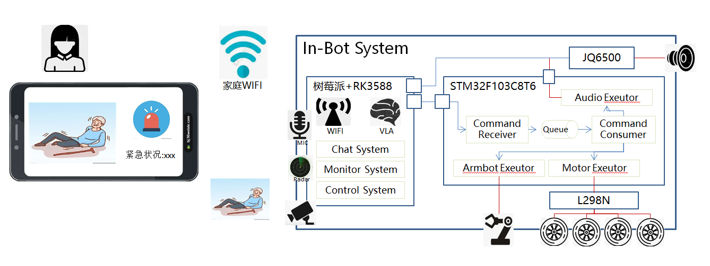
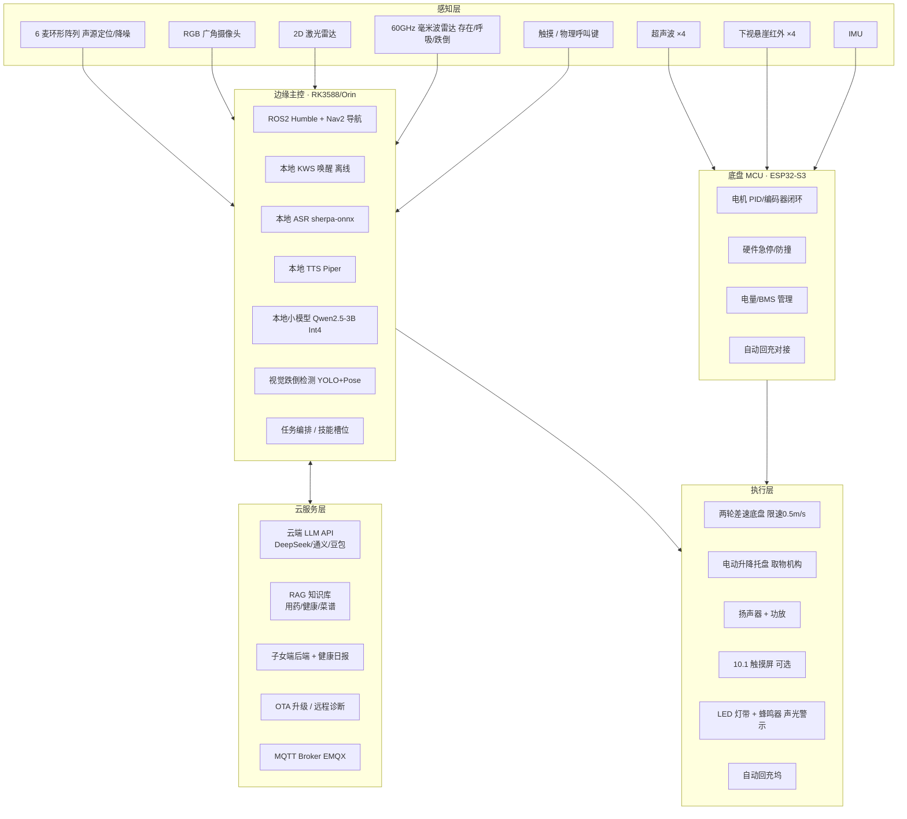
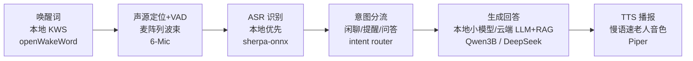
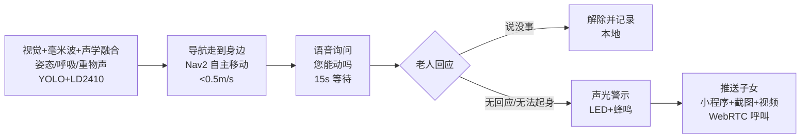
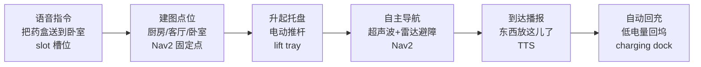

# RUSH-BOT · 老年陪伴机器人

> **SYSTEM DESIGN · V0.1**
>
> 面向独居/空巢老人的室内陪伴机器人：语音问答与生活提醒、自主移动与定点递送、本地视觉跌倒监测并联动子女告警。

系统架构

## 一句话定位

不是"保姆型人形机器人"，而是一台 **会自己走动的"语音管家 + 安全哨兵 + 定点物流小车"**。MVP 阶段把"帮老人拿东西"务实降级为"定点托盘递送"，不做通用机械臂抓取。

- 老人端零操作（语音为主）
- 告警低漏报 / 极低误报
- 视频本地处理，隐私不出户
- 毫米波兜底夜间/无灯看护
- 经济型 BOM < ¥3,500
- **⚠ 移动限速 < 0.5 m/s，硬件急停**

---

## 01 产品边界与核心场景

先划清"做什么 / 不做什么"，避免功能膨胀。

- **做：** 语音问答与闲聊、生活常识/用药提醒、日程提醒、跟随/定点递送物品、跌倒/异常检测、一键呼叫子女。
- **不做（MVP）：** 通用机械臂抓取任意物体、做饭/倒开水、医疗诊断、室外移动、上下楼梯。
- **用户：** 老人侧（70+，以语音交互为主）；子女侧（30–50 岁，用微信小程序收告警、看日报，不用装 App）。
- **核心矛盾：** 技术上"抓取/行走"都可做，但家庭环境杂乱 + 老人配合度低 + 安全风险高，**可靠性比功能丰富重要十倍**。

---

## 02 总体架构（五层 + 双终端）

云端大模型做"大脑"，边缘小模型做"神经"，MCU 做"脊髓"。

**老人端：** 全程语音交互；屏上只放超大字（吃药时间/大按钮）；一个红色物理"呼叫子女"按钮兜底。

**子女端（微信小程序）：** 实时告警推送、现场截图/10s 短视频、远程视频通话、老人日报（活动/提醒完成率）。

---

## 03 三条核心链路

### 链路 A · 语音问答与陪伴

> 本地兜底，弱网可用；只有复杂问答才上云。

### 链路 B · 跌倒检测与子女告警（最高优先级）

> 多传感器融合 + 机器人到场语音确认，避免"狼来了"。

> 隐私：视频本地推理，仅告警事件上传 10 秒片段；60GHz 毫米波不成像、不拍画面，可作摄像头关闭/夜间时的兜底看护，老人/子女侧均明示告知。

### 链路 C · "帮拿东西"（务实降级方案）

> MVP 不做机械臂，做"定点托盘物流"与"跟随递送"。

> 模式 B：按托盘上按钮 → 机器人跟随老人行走，随时取放；V2 再探索轻量协作臂 + VLA 抓取指定物品。

---

## 04 硬件选型

两档：经济型量产 / 性能型研发。

| 模块 | 推荐选型（经济型） | 备选 / 性能型 | 参考价 | 说明 |
| --- | --- | --- | --- | --- |
| 边缘主控 | RK3588 开发板 8GB | Jetson Orin Nano 8GB | ¥600–900 / ¥2,200 | 经济型跑 ASR/TTS/导航够用；Orin 跑视觉+VLA 探索 |
| 底盘 MCU | ESP32-S3 | STM32F407 | ¥25–40 | 电机 PID、硬急停、电量、回充对接 |
| 激光雷达 | LD19 三角测距（8–12m） | RPLIDAR A1/A2 | ¥150–400 | 室内建图导航足够 |
| 毫米波雷达 | 60GHz HLK-LD2410 / LD6001（存在+呼吸+跌倒） | Seeed XIAO 60GHz / 77GHz 车载级 | ¥30–80 | 无成像、隐私友好、暗光可用；UART 接入，补摄像头盲区与夜间看护 |
| 视觉摄像头 | 2MP 广角 USB Cam（FoV ≥ 120°） | RealSense D435i（深度） | ¥150 / ¥1,500 | 跌倒检测用 RGB+姿态即可；深度相机用于 V2 |
| 麦克风阵列 | 6 麦环形阵列 / ReSpeaker | 双麦 HAT | ¥200–500 | 声源定位 + 降噪，远距离拾音关键 |
| 扬声器+功放 | 3W 全频喇叭 + PAM8403 | — | ¥30 | 老人听力差，音量要大且不刺耳 |
| 移动底盘 | 两轮差速 + 编码减速电机（轮径 180mm） | 阿克曼/全向轮 | ¥400–700 | 橡胶轮适配木地板/短毛地毯 |
| 近距避障 | 超声波 ×4 + 下视悬崖红外 ×4 | — | ¥40 | 防桌腿、防楼梯口 |
| 取物机构 | 电动升降托盘（行程 15–25cm） | 固定托盘 / 桌面协作臂 myCobot | ¥80–150 / ¥3,000+ | MVP 核心；机械臂仅 V2 探索 |
| 电池 | 12V 20Ah 锂电 + BMS | — | ¥300–450 | 续航 4–6h，自动回充补电 |
| 回充坞 | 触点式充电坞 | — | ¥100 | 红外对准 + 触点弹针 |
| 显示屏（可选） | 10.1" 触摸屏 1280×800 | 纯语音无屏版 | ¥300–500 | 超大字 UI / 视频通话窗口 |
| 声光警示 | LED 灯带 + 无源蜂鸣器 | — | ¥30 | 跌倒告警现场吸引注意 |
| 结构外壳 | 钣金 + 3D 打印件样机 | 量产注塑 | ¥350–500 | 圆角防磕碰，重心低防倾倒 |

---

## 05 软件与算法栈

边缘 ROS2 + 云端大模型。

| 模块 | 选型 | 理由 / 备注 |
| --- | --- | --- |
| 系统 / 中间件 | Ubuntu 22.04 + ROS2 Humble | 导航生态最成熟，Nav2 开箱可用 |
| 建图 / 导航 | SLAM Toolbox（或 Cartographer）+ Nav2 | 家庭平面房间建图，固定点"厨房/卧室"导航 |
| 语音唤醒 KWS | openWakeWord / Porcupine | 本地离线唤醒，不依赖云 |
| ASR 语音识别 | sherpa-onnx（Zipformer 本地）+ 云端大 ASR 兜底 | 弱网可降级；老人口音需后续微调 |
| TTS 语音合成 | Piper（本地，慢语速/大音量音色） | 语气要温和，不要机械感 |
| 本地小模型 | Qwen2.5-3B-Instruct Int4（llama.cpp / Ollama） | 隐私兜底闲聊，断网可用 |
| 云端 LLM | DeepSeek / 通义千问 / 豆包 API | 复杂问答 + RAG 生成 |
| RAG 知识库 | FAISS / Milvus Lite + bge-m3 embedding | 老人常用药禁忌、家常菜谱、社区医院电话 |
| 视觉 / 存在感知 | YOLOv8-nano + MediaPipe Pose + 60GHz 毫米波 UART 驱动 | 本地推理判断倒地姿态；融合毫米波存在/呼吸与声学事件降噪误报 |
| 后端服务 | FastAPI / Go + PostgreSQL + Redis | 设备影子、日程、告警记录 |
| 通信 | MQTT（EMQX）事件上报 + WebRTC 音视频 | 小程序告警推送、一键视频通话 |
| 子女端 | 微信小程序 | 免安装、消息直达，告警触达率高 |
| 部署 | Docker Compose（边缘侧）+ 云主机 | OTA 差分升级，远程日志诊断 |

---

## 06 BOM 成本估算（样机级）

未含开模/研发/人工。

### ECONOMIC · 量产目标档 —— RK3588 方案

**≈ ¥3,350 / 台**

- 主控 RK3588 + 屏 + 雷达 LD19 + 60GHz 毫米波
- 6 麦阵列、差速底盘、升降托盘
- 12V 20Ah 电池 + 回充坞
- 定位：C 端可售，毛利可做

### PERFORMANCE · 研发/高配档 —— Jetson Orin 方案

**≈ ¥7,200 / 台**

- Orin Nano + RealSense D435i
- RPLIDAR A2、高配屏
- 预留 VLA / 机械臂算力
- 定位：样机/标杆客户演示

---

## 07 关键风险与 MVP 路线

先把"安全哨兵"做扎实，再谈"智能"。

### 风险与对策

**跌倒检测误报率** — 单次误报就消耗子女信任，三次误报后告警被无视。
对策：视觉+声学融合，到场语音二次确认，无回应才升级。

**"拿东西"预期落差** — 老人/子女期待"从桌上抓水杯"，现实做不到。
对策：宣传与产品定义统一为"定点递送/跟随托盘"，不承诺抓取。

**老人不愿跟机器人说话** — 陪伴类产品最大死因不是技术，是老人弃用。
对策：主动发起（定时提醒/闲聊），一个物理大按钮兜底，音色温和。

**摄像头隐私合规** — 家里有摄像头，老人/子女都会有顾虑。
对策：视频本地推理不出户，仅告警事件上传片段，明示同意+物理遮罩。

### MVP 迭代路线

- **P0 · 8 周 — MVP 跑通：** 差速底盘 + Nav2 建图导航 + 语音问答/提醒 + 物理呼叫按钮。不做跌倒检测。
- **P1 · 12 周 — 安全哨兵：** 本地视觉跌倒检测 + 到场确认 + 微信小程序告警推送 + 自动回充。这是产品卖点。
- **P2 · 16 周 — 递送 + 打磨：** 定点托盘物流 + 跟随模式 + RAG 生活常识库 + 老人 UX 调优（大字号/慢语速）。
- **V3 · 探索 — 机械臂 / VLA：** 仅在 P1/P2 验证可靠性后，再评估轻量协作臂 + VLA 抓取指定物品。

---

> 老年陪伴机器人系统设计 V0.1 · 架构分层 / 硬件选型 / 软件栈 / BOM 估算 · 价格为样机级参考，量产成本需按采购批量重核。
